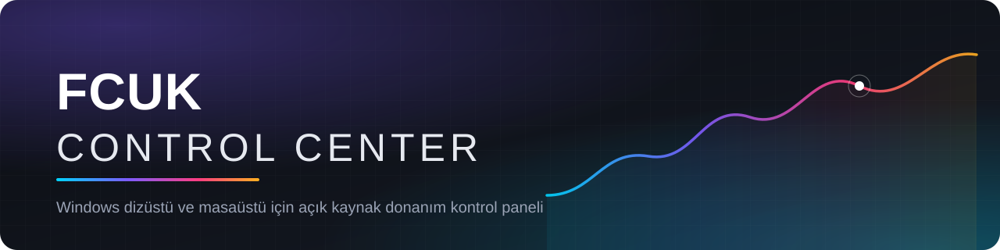
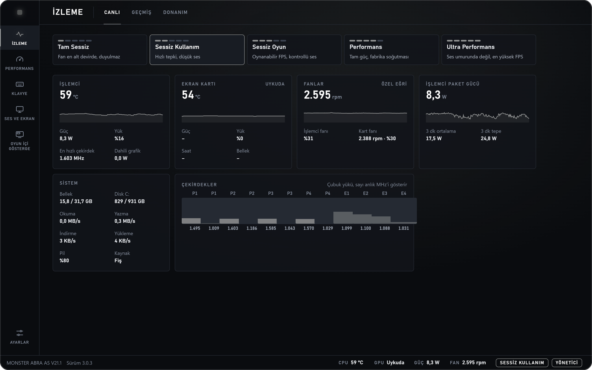
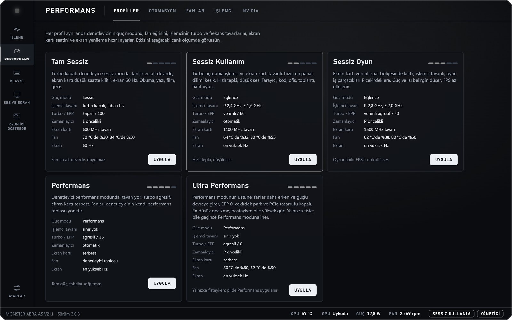
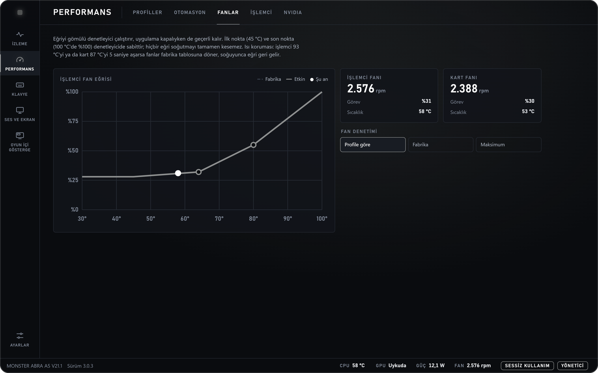
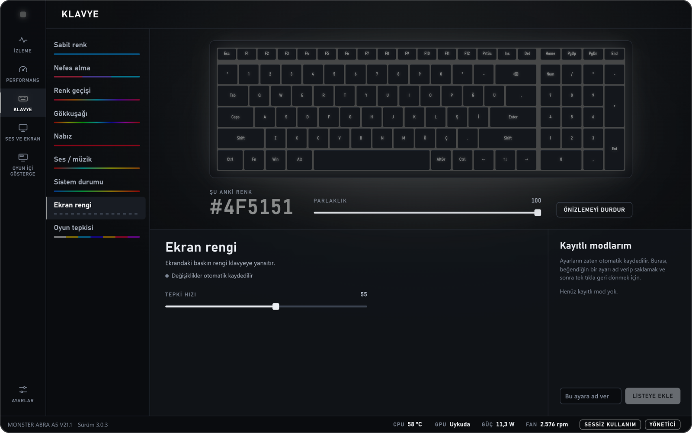
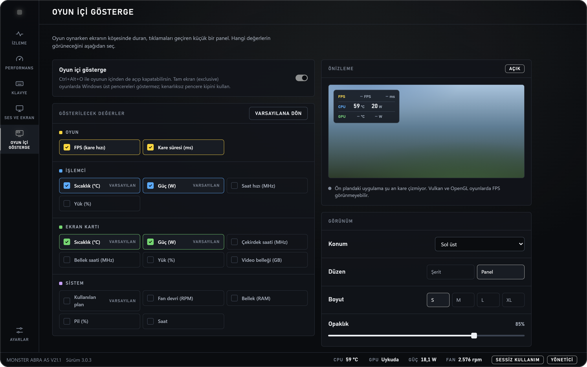
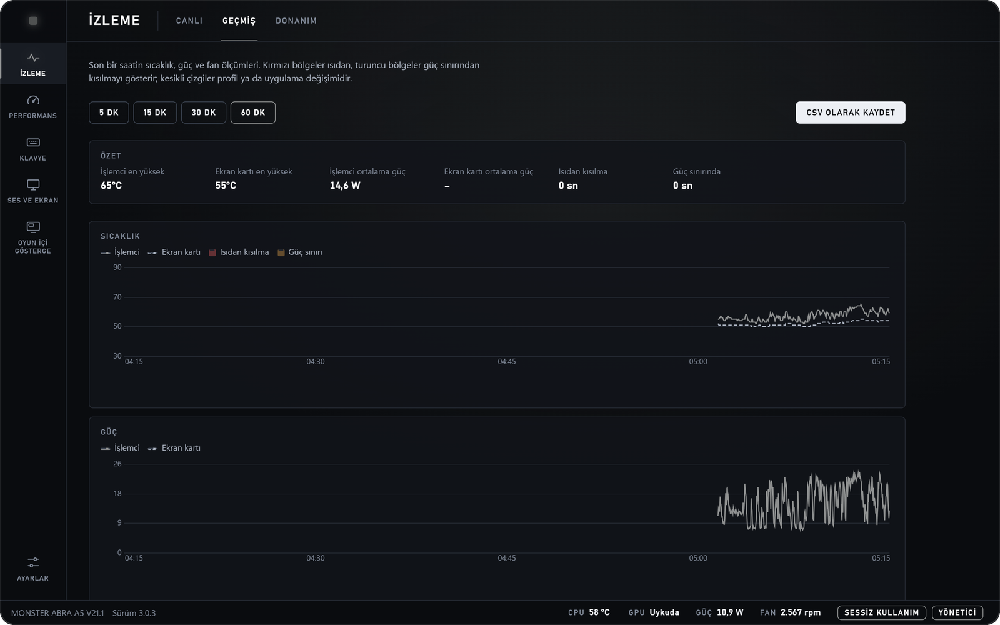
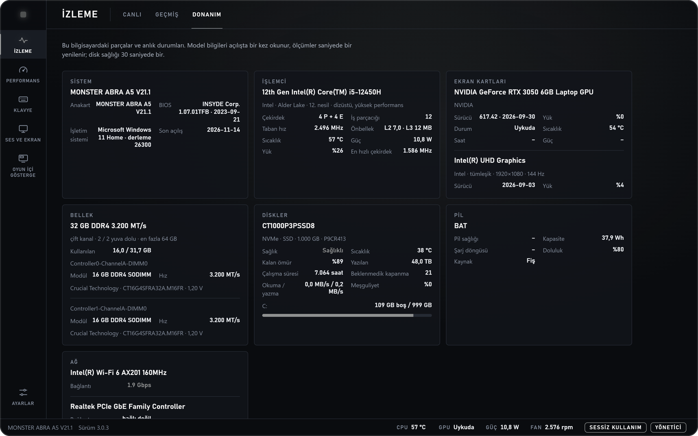
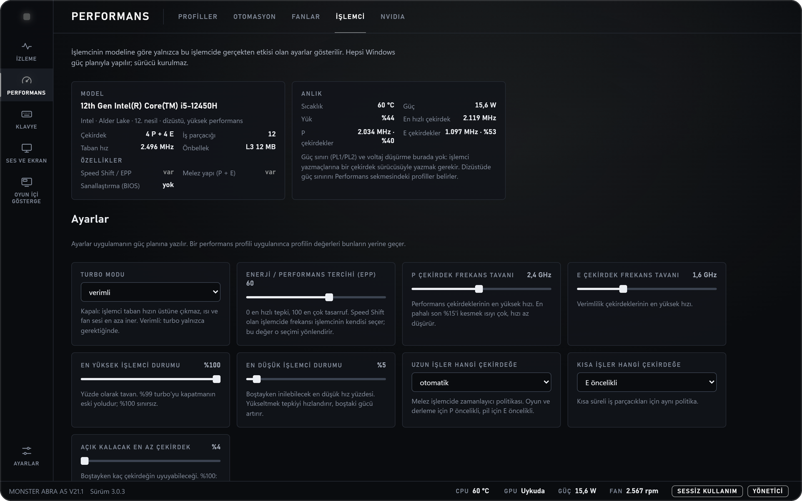

<div align="center">



<br>

[](https://github.com/kuheylanstudio/fcuk-control-center/releases/latest)
[](https://github.com/kuheylanstudio/fcuk-control-center/releases)
[](https://github.com/kuheylanstudio/fcuk-control-center/actions/workflows/testler.yml)
[](LICENSE)


### Ditch the vendor Control Center.<br>Fans, power modes, keyboard lighting and performance from one lightweight app.

**English** · [Türkçe](README.md)

<a href="https://github.com/kuheylanstudio/fcuk-control-center/releases/download/v3.0.3/FCUK-Control-Center-Setup-3.0.3.exe"></a>
<br>
<a href="https://www.virustotal.com/gui/file/23d85e7bb5390a8a9a2f374b74787464a87d77acb52849303583c0c1611c4bb9"></a>
<br>
<sub>Windows 10/11 (64-bit) · <a href="https://github.com/kuheylanstudio/fcuk-control-center/releases/latest">all releases and SHA-256</a> · <a href="#security-and-verification">security and verification</a></sub>

<br>

[Highlights](#highlights) · [Screenshots](#screenshots) · [Supported devices](#supported-devices) · [Installation](#installation) · [Disclaimer](#disclaimer)

<br>



</div>

<br>

> ⚠️ **Warning:** This software changes hardware settings (fans, power modes, CPU/GPU limits, embedded controller) and is
> provided "as is", without warranty. The developer is not liable for any damage arising from its use; all risk is
> yours. Details: [Disclaimer](#disclaimer).

An open-source, lightweight, full-featured control panel for Windows laptops and desktops.
On Monster / Clevo laptops it completely replaces the manufacturer's Control Center. On **Alienware / Dell G** and
**Asus ROG / TUF** laptops it manages power mode, fans and keyboard lighting alongside the vendor's own app. On other
computers, hardware detection, live monitoring, NVIDIA and CPU settings still work.

> The source code of this project was written with Anthropic's **Claude Opus 5.5** AI model.

## Highlights

<table>
<tr>
<td width="33%" valign="top">

### ⚡ 5 performance profiles
From Silent to Ultra Performance. Each profile sets power mode, fan curve, CPU/GPU limits and refresh rate **in one click**.

</td>
<td width="33%" valign="top">

### 🌀 Custom fan curve
Run by the embedded controller, so it stays active when the app is closed. Falls back to the factory table when overheating.

</td>
<td width="33%" valign="top">

### 🎹 Keyboard RGB + game reactions
9 lighting modes. Health color in League of Legends, shots and kills in Counter-Strike 2. Game memory is never touched.

</td>
</tr>
<tr>
<td width="33%" valign="top">

### 📊 Live monitoring and history
CPU, GPU, disks, memory, network and battery. 1-hour charts, throttling zones and CSV export.

</td>
<td width="33%" valign="top">

### 🎮 In-game overlay
FPS, frame time, temperatures, power and more in a click-through panel. Toggle with **Ctrl+Alt+O**.

</td>
<td width="33%" valign="top">

### 🔄 Self-updating
Checks GitHub releases, verifies SHA-256 and installs. Automatic or manual.

</td>
</tr>
</table>

<div align="center">

**Lightweight** · no kernel driver · **Open source** (MIT) · **14 languages** · no telemetry

</div>

## Screenshots

<table>
<tr>
<td width="50%"><br><sub><b>Performance profiles</b>: five presets, one click</sub></td>
<td width="50%"><br><sub><b>Fan curve</b>: curve, live point and fan control</sub></td>
</tr>
<tr>
<td width="50%"><br><sub><b>Keyboard RGB</b>: live preview, 9 modes, saved modes</sub></td>
<td width="50%"><br><sub><b>In-game overlay</b>: pick values, live preview</sub></td>
</tr>
<tr>
<td width="50%"><br><sub><b>History</b>: temperature, power, fan and throttling</sub></td>
<td width="50%"><br><sub><b>Hardware</b>: CPU, GPU, memory, disk health, battery</sub></td>
</tr>
<tr>
<td width="50%"><br><sub><b>CPU</b>: only the settings that matter for your model</sub></td>
<td width="50%" valign="middle" align="center"><sub>Screenshots taken on a Monster Abra A5 (Core i5-12450H, RTX 3050), version 3.0.3. The app UI is shown in Turkish; 14 languages are available.</sub></td>
</tr>
</table>

## Quick start

1. **[Download the installer](https://github.com/kuheylanstudio/fcuk-control-center/releases/download/v3.0.3/FCUK-Control-Center-Setup-3.0.3.exe)** and double-click it.
2. Approve the administrator prompt; setup detects your device and applies only the steps for it.
3. The app opens. Pick a **performance profile**.

> If Windows SmartScreen says "Windows protected your PC": **More info → Run anyway**. See [Security and verification](#security-and-verification).

## All features

| Section | What it does | Requires |
|---|---|---|
| **Hardware** | CPU (model, architecture, generation, P/E core layout, cache), GPUs and driver versions, memory modules (slot, capacity, speed, type, manufacturer), disks (model, NVMe/SATA, temperature, remaining life, TB written, power-on hours), motherboard, BIOS, battery health, network adapters, display | Any computer |
| **Live monitoring** | CPU temperature/power/load, per-core MHz, GPU temperature/power/clock/VRAM/PCIe/throttle reason, integrated graphics load, per-disk read/write speed, memory, network, battery | Any computer |
| **NVIDIA** | Power management mode, low latency, V-Sync, max frame rate, texture filtering, threaded optimization, preferred GPU (Optimus), manual clock limit. Settings are written to the same driver profile the NVIDIA Control Panel uses | NVIDIA GPU; admin mode to write |
| **CPU** | Only the settings that are effective for your CPU model: turbo mode, EPP (Speed Shift), P and E core frequency caps (hybrid Intel), processor state limits, core scheduler policy, core parking | Any computer (Windows power plan) |
| **Performance profiles** | Five profiles, Silent → Ultra Performance; each sets embedded-controller power mode, fan curve, CPU, GPU and display refresh rate together. Steps the device lacks are skipped and shown in the report | Clevo / Monster, Alienware, Asus, Lenovo Legion, Lenovo IdeaPad, MSI, HP Omen / Victus, Acer Predator / Nitro, Gigabyte (power mode) |
| **Fans** | Custom fan curve, fan speed and temperature readout | Clevo / Monster, Alienware, Asus, Lenovo Legion (in Custom mode), Gigabyte; fan mode / full speed on MSI, HP and Acer (model dependent) |
| **Keyboard RGB** | 9 lighting modes: static, breathing, color cycle, rainbow, pulse, audio/music, system status, screen color and **game reaction**; per-zone colors on 4-zone keyboards | Clevo / Monster, Alienware (AlienFX), Asus (Aura), Lenovo Legion, MSI (USB keyboard), HP Omen, Acer Predator / Nitro, Gigabyte (ITE) |
| **Game reaction** | The keyboard shifts from green to red with your health, pulses like a heartbeat below 35% health, and flashes on shots, abilities, kills and deaths. **League of Legends** (Riot's official live game data) and **Counter-Strike 2** (official Game State Integration). Game memory is never touched | Device with keyboard RGB |
| **Asus-specific** | Charge limit, GPU mode (Eco / Standard / Ultimate) | Asus ROG / TUF (model dependent) |
| **Fn keys** | On-screen notifications for Fn keys | Clevo / Monster |
| **Lenovo Legion-specific** | GPU mode (hybrid / integrated / discrete only), battery conservation and rapid charge, full-speed fan | Lenovo Legion (model dependent) |
| **MSI-specific** | Shift / fan mode, Cooler Boost, battery charge limit | MSI (models whose EC firmware is in the table) |
| **Battery charge limit** | Stops charging at a value between 60% and 100% | Gigabyte, MSI (model dependent) |
| **Audio and display** | Speaker / microphone level, refresh rate | Any computer |
| **Per-app profile** | When a program you choose (e.g. `game.exe`) starts, the profile you want is applied; when it closes, the previous profile returns. Add from open windows or by exe name | Device with profile support |
| **Custom profiles** | Up to 3 of your own profiles based on a built-in one: CPU / GPU limits, turbo, fan curve (start and full-speed points), refresh rate | Device with profile support |
| **In-game overlay** | Its own category: pick each value to show (CPU/GPU temperature, W, MHz, load, VRAM, FPS, frame time, plan, fan, RAM, battery, clock). Default: CPU and GPU temperature + W + active plan. Strip/panel layout, 4 sizes, opacity, live preview. FPS comes from Windows ETW events without touching the game (DirectX 9–12, admin mode). Toggle with Ctrl+Alt+O | Any computer |
| **Hotkeys** | Ctrl+Alt+P next profile, Ctrl+Alt+O in-game overlay | Any computer |
| **History** | Temperature / power / fan charts for the last hour, throttling (thermal / power) regions, profile-change markers, CSV export; optional daily CSV log (kept 7 days) | Any computer |
| **Battery health history** | Ratio of full-charge capacity to design capacity logged daily; yearly loss estimate after 30 days | Computer with a battery |
| **Diagnostics** | One-click report for bug reports (version, model, BIOS, feature support, log); user and computer names are stripped, nothing is sent anywhere. Recent errors appear in Settings | Any computer |
| **Updates** | Checks GitHub for a new version, downloads, verifies with SHA-256 and installs. Automatic or manual; release notes are shown before installing | Any computer (installed via setup.exe) |
| **Language** | 14 languages, automatic from the Windows region setting | |

### Supported devices

| Device | Status |
|---|---|
| **Monster / Clevo** | Full support: replaces the manufacturer's Control Center |
| **Alienware / Dell G** (16 Aurora, 16X Aurora and AWCC models) | Power mode (Quiet, Balanced, Performance/G-mode), fan curve in "Custom" profile, temperature and fan speed, AlienFX keyboard lighting (single color). If the Fn key or Alienware Command Center changes the profile, the app detects it and shows the real mode |
| **Asus ROG / TUF** | Power mode (silent, balanced, turbo), 8-point fan curve, fan speed, keyboard backlight and Aura RGB, charge limit, GPU mode. Every feature is probed first; no command is sent for a feature the model lacks |
| **Lenovo Legion** | Power mode (Quiet, Balanced, Performance) with profiles, fan speed and temperature, full-speed fan, fan curve in Custom mode, GPU mode (hybrid / integrated / discrete only), battery conservation and rapid charge, all lighting modes on 4-zone keyboards. Every feature is probed first; an unsupported feature sends no command |
| **Lenovo IdeaPad** (Intel and Ryzen) | Depending on the Lenovo interface the model offers: power mode (Quiet, Balanced, Performance; same as Fn+Q, GameZone WMI), battery mode (normal, conservation, rapid charge; Energy Management driver), CPU/GPU temperature and fan speed. Fans are always run by firmware (no custom fan curve); keyboard lighting stays with Fn+Space. On models without a power mode, profiles still set the Windows power mode |
| **MSI** | Power mode (shift mode) with profiles, fan mode and Cooler Boost, temperature and fan speed, battery charge limit, USB keyboard lighting (SteelSeries / 3-zone). If the EC firmware is not in the table, read-only (details below) |
| **HP Omen / Victus** | Thermal mode (cool / balanced / performance) with profiles, full-speed fan, temperature and fan speed, 4-zone keyboard lighting. Features are probed from the BIOS by reading only; missing features are hidden |
| **Acer Predator / Nitro** | Power profile, fan mode (auto / max), temperature and fan speed, 4-zone RGB keyboard (including zone colors). Features are probed by reading only |
| **Gigabyte / AORUS / AERO** | Silent / normal / gaming fan mode (the power-mode step of profiles), 15-point custom fan curve, fixed fan speed, temperature and fan speed, battery charge limit (60–100%), single-color RGB on ITE keyboards. Clevo-based models use the Clevo path |
| **Other computers** | Hardware, live monitoring, NVIDIA, CPU, audio and display. Fan and keyboard pages say "Not available on this computer" |

Alienware, Asus, Lenovo, MSI, HP, Acer and Gigabyte support has not been tested on real devices yet; please report any
problems. On non-Clevo computers the app touches the controller, fans, keyboard and Fn keys only if a supported device
is actually present. Vendor apps such as Armoury Crate, Alienware Command Center, Vantage, MSI Center and Omen are not
removed; they work side by side. If both change the same setting, the last one to change wins.

Power limits (PL1/PL2) and undervolting are intentionally absent: they require writing to CPU registers (MSR) through
a kernel driver. The app installs no kernel driver.

## Installation

### setup.exe (recommended)

1. Download **[FCUK-Control-Center-Setup-3.0.3.exe](https://github.com/kuheylanstudio/fcuk-control-center/releases/download/v3.0.3/FCUK-Control-Center-Setup-3.0.3.exe)**.
2. Double-click it and approve the administrator prompt. The installer window shows every step; the app opens when it finishes.
3. If Windows says "Windows protected your PC" (SmartScreen): **More info → Run anyway**. Details:
   [Security and verification](#security-and-verification).

### Security and verification

- **VirusTotal:** [scan report for the 3.0.3 installer](https://www.virustotal.com/gui/file/23d85e7bb5390a8a9a2f374b74787464a87d77acb52849303583c0c1611c4bb9)
  (the badge above links to the same report). New releases are uploaded to VirusTotal via GitHub Actions; the report
  link is appended to the release notes. Programs packaged with PyInstaller are sometimes falsely flagged by a few
  antivirus engines (under generic names such as "Trojan/Wacatac"); the full source code is in this repository.
- **SHA-256:** verify that the file you downloaded matches the hash on the [release page](https://github.com/kuheylanstudio/fcuk-control-center/releases/latest):
  `Get-FileHash FCUK-Control-Center-Setup-3.0.3.exe`
- **Code signing:** the installer is currently not code-signed; that is why SmartScreen warns. The build script is
  ready for signing (see [Code signing](#code-signing)); once a signed release is published, the updater installs only
  installers carrying the same publisher's signature.

The downloaded installer does **not** contain the manufacturer's DLL. On Clevo / Monster laptops the app uses
`InsydeDCHU.dll` from the AcpiBridge driver in the Windows driver store; you do not need to do anything extra.

A single setup.exe installs on any computer. The installer detects the device from hardware (Clevo, Alienware, Asus,
Lenovo, MSI, HP, Acer, Gigabyte) and applies **only the steps for that device**. Outside Clevo, none of the Monster /
Clevo steps below are performed, no vendor software, driver or service is removed, and no restart is requested.

On a Monster / Clevo laptop, `setup.exe` installs the app to `C:\Program Files\FCUK Control Center` and takes the
place of the manufacturer's Control Center:

- **The manufacturer's uninstaller is not run.** That uninstaller (InstallShield + `RemoveAPP.exe`) also deletes the
  AcpiBridge drivers; without them fan, power mode, keyboard lighting and Fn keys stop working. setup.exe removes the
  old components itself and backs up each one:
  - Fn key / OSD package, Control Center 3.0, fan, keyboard lighting and power-saving application packages
  - The `Program Files (x86)\ControlCenter` folder, InstallShield registration, shortcuts, startup entries and tasks
- Old Fn programs are blocked by **full path** (IFEO path filter): only the copies in the Monster package, the old
  Control Center folder and the CCDCHUService folder. Other software with the same name is left alone. If a Windows
  package reinstalls them, the admin engine blocks the new path at startup and every 30 minutes.
- **Preserved:** the AcpiBridge drivers and the CCDCHUService service. Setup first creates a restore point and exports
  the drivers. At the end it verifies the drivers are in place and reinstalls from backup if any is missing.
- Packages with no counterpart in this app are left alone: CPU/GPU overclocking, Flexikey and the battery utility.
- At the end of setup it checks that the engine runs in admin mode, is connected to the embedded controller, that fan
  readings arrive and that the tray / Fn listener is running.
- Backups go to `C:\ProgramData\FCUK Control Center\yedek\<date>`, and the log is written as `kurulum.log` in the same folder.
- To uninstall: Settings → Apps → FCUK Control Center → Uninstall.

For silent installation use `setup.exe /S`. Exit code 0 means success, 2 success with warnings, 1 error.

### Updates

Since 2.1.0 the app updates itself from GitHub (Settings → Updates):

- **Automatic** (default): a new version is checked, downloaded and verified. A what's-new window opens and
  installation starts after 45 seconds; you can choose "Install now" or "Not this time".
- **Manual:** a new version is only announced; you read the release notes and install it yourself with "Download and install".

The file is downloaded only over HTTPS from this repository's releases page and verified with the SHA-256 digest
GitHub provides. Installation runs through an update interface independent of the app, with its own window
(`setup.exe /guncelle`): when installation starts the app window closes, the update window shows the steps (prepare,
close, files, settings, start) and elapsed time, and the new version opens by itself when done. On error the window
shows the reason and the log file. Settings are preserved. Notes of skipped versions also appear in the what's-new window.
If you use 2.0.x you must install 2.1.0 manually once; later versions arrive automatically.

#### Building it yourself

You can also build setup.exe from source (requires Python 3.10+):

```powershell
git clone https://github.com/kuheylanstudio/fcuk-control-center.git
cd fcuk-control-center
pip install -r requirements.txt pyinstaller
powershell -ExecutionPolicy Bypass -File lib\dll_topla.ps1   # copies the manufacturer DLL from this computer into lib\
powershell -ExecutionPolicy Bypass -File setup_olustur.ps1   # output: dist\setup.exe
```

`setup_olustur.ps1` also runs `lib\dll_topla.ps1` if the DLL is missing. Details: the
[Manufacturer DLL](#manufacturer-dll-insydedchudll) section below.

A setup.exe built this way contains the manufacturer's DLL; use it on your own computer and do not distribute it
publicly. For a distributable (DLL-free) package: `setup_olustur.ps1 -Dagitim` (output:
`dist\FCUK-Control-Center-Setup-3.0.3.exe`). This is the file behind the download button.

#### Code signing

If you have a code-signing certificate, `setup_olustur.ps1` signs the app exe (before it is embedded in setup.exe) and
setup.exe with `signtool`. Requires the Windows SDK; if none of the environment variables is set, it builds unsigned.

```powershell
$env:FCUK_IMZA_PFX = 'C:\certificate\sign.pfx'; $env:FCUK_IMZA_PAROLA = '...'   # with a .pfx file
# or with a certificate in the certificate store / on a hardware key:
$env:FCUK_IMZA_PARMAKIZI = '<SHA-1 thumbprint>'
# optional: $env:FCUK_IMZA_ZAMAN = 'http://timestamp.digicert.com'
powershell -ExecutionPolicy Bypass -File setup_olustur.ps1 -Dagitim
```

If a certificate is set but signing fails, the build stops (no half-signed package is produced). If the installed app is
signed, the updater requires the new installer to be validly signed and from the same publisher (certificate subject);
otherwise it will not install the file and shows why.

### From source

Requires: Windows 10/11 (64-bit), Python 3.10+ and the WebView2 runtime (for the window; ships with Windows 11, otherwise
the app falls back to an Edge/Chrome window).

```powershell
git clone https://github.com/kuheylanstudio/fcuk-control-center.git
cd fcuk-control-center
pip install -r requirements.txt
pythonw control_center.py
```

To build an exe, install it under `C:\Program Files` and start the admin engine at Windows startup:

```powershell
pip install pyinstaller
powershell -ExecutionPolicy Bypass -File kur.ps1
```

### Manufacturer DLL (InsydeDCHU.dll)

On Clevo / Monster laptops, fan, power mode, keyboard lighting and Fn keys talk to the embedded controller through
`InsydeDCHU.dll`. This file belongs to the manufacturer and is **not** in this repository because its license does not
permit redistribution. It is the only file needed (`GetProductdll.dll` and the Visual C++ DLLs are not required).

**Where to find it?** It is already on your Clevo / Monster laptop:

| Location | Note |
|---|---|
| `C:\Windows\System32\DriverStore\FileRepository\acpibridge*\InsydeDCHU.dll` | Comes with the AcpiBridge driver; stays even if the manufacturer's Control Center is uninstalled. Microsoft-signed. |
| `C:\Program Files (x86)\ControlCenter\DCHU\` | If the manufacturer's Control Center is installed |
| Microsoft Store "Fn hotkeys and OSD" package, `FnKey\DCHU\` | If installed |
| `C:\ProgramData\FCUK Control Center\yedek\` | Backup setup.exe took from the old Control Center |
| Manufacturer's support page | Download and extract your model's "Control Center" or "AcpiBridge / DCHU" driver package |

**How to add it to the project?**

```powershell
powershell -ExecutionPolicy Bypass -File lib\dll_topla.ps1
```

The script searches the locations above in order, copies the file it finds to `lib\InsydeDCHU.dll`, and shows its
version and signature. It does not ask for admin rights and downloads nothing. To do it by hand, just copy the file into
`lib\`. Details: [lib/README.md](lib/README.md).

When running from source, or in an exe built without the DLL, if the app finds no file in `lib\` it looks in the driver
store itself. If the file is nowhere (a non-Clevo / Monster computer) the app still starts; only features that depend on
the embedded controller are turned off.

`kur.ps1` disables the Clevo Fn key package (FnKey / old Control Center interface); this step runs only on computers
with an AcpiBridge device (ACPI\CLV0001).

## Admin mode

Writing the GPU clock limit and NVIDIA driver settings requires administrator rights. Settings → *Install admin mode*
asks for UAC once and adds a task to Task Scheduler; after that the engine starts as administrator at every startup
without a UAC prompt. The window and tray icon always run with normal user rights.

## Architecture

```
control_center.py  entry point, local HTTP server (127.0.0.1:47815 only), tasks
donanim.py         embedded controller (DCHU), device detection, PDH counters, NVML, display, audio, sensor loop
alienware.py       Alienware / Dell G backend (AWCC WMI, AlienFX HID)
asus_rog.py        Asus ROG / TUF backend (ATK ACPI-WMI, Aura HID)
wmi_com.py, hid_win.py  WMI and USB HID access with no extra packages
guncelleme.py      GitHub update check, download, verification and installation
lenovo_legion.py   Lenovo Legion backend (GameZone WMI), lenovo_wmi.py (WMI), lenovo_kb.py (keyboard HID)
ideapad.py         Lenovo IdeaPad backend (GameZone WMI, Energy Management driver)
envanter.py        hardware inventory (CIM), P/E core detection, NVMe SMART and disk temperature (IOCTL)
nvidia.py          NVIDIA driver settings (NVAPI DRS), card info (NVML)
islemci.py         model-aware CPU settings (Windows power plan)
profiller.py       five performance profiles, custom profiles, thermal protection, plug/battery and app rules
kayit.py           sensor history (1 hour in memory, optional daily CSV), throttle type, battery health history
gosterge.py        in-game overlay (layered, click-through, always-on-top window)
kare.py            FPS measurement (ETW: DXGI/D3D9 Present events; does not touch the game)
tanilama.py        diagnostics report and recent errors (stripped of personal information)
klavye_rgb.py      keyboard lighting engine
oyun.py            game reaction sources: key presses, LoL live game data, CS2 Game State Integration
hp_omen.py         HP Omen / Victus backend (HP BIOS WMI: thermal mode, fan, temperature, 4-zone keyboard)
acer_predator.py   Acer Predator / Nitro backend (AcerGamingFunction WMI: power profile, fan, 4-zone keyboard)
msi.py             MSI: EC firmware table and safety rules (shift/fan mode, Cooler Boost, battery limit)
msi_wmi.py         MSI_ACPI (root\WMI) transport layer, driverless
msi_klavye.py      MSI USB keyboard lighting (SteelSeries 1038, older 3-zone 1770)
gigabyte_aorus.py  Gigabyte/AORUS/AERO backend (GB_WMIACPI fan, mode, temperature, charge limit; ITE keyboard)
wmi_yontem.py      package-free WMI method calls (COM, single thread)
hid_rapor.py       package-free HID feature reports (hid.dll)
engelle.py         blocks old Monster Fn programs by full path (IFEO path filter)
fntus.py, tepsi.py Fn keys, on-screen notification, tray icon, global hotkeys (separate, normal-privilege process)
ceviri.py, ui/lang language files; tools/ceviri_denetle.py language file checker
ui/index.html      interface (pencere.py: pywebview/WebView2 window; fallback: Edge --app); ui/gecmis.js History page
pencere.py         single-instance window process with its own title bar and taskbar button (--window)
```

To bypass the installed engine and run the code directly during development: `python control_center.py --dev`

### Tests

Tests never touch hardware (fake WMI / HID / embedded controller). They run on Windows in GitHub Actions on every push
(`.github/workflows/testler.yml`).

```powershell
python -m unittest discover -s tests        # unit tests
python tools/ceviri_denetle.py              # language files: missing / extra keys, placeholders, keys in code
```

When adding a new UI string, add it to `ui/lang/tr.json` and `en.json` first, then the other languages; the checker
shows which language is missing.

## MSI laptops (experimental, not verified on real hardware)

If the manufacturer is `Micro-Star International`, `msi.py` takes over. The embedded controller is reached without
installing any extra driver through MSI's own `MSI_ACPI` WMI class (Get_EC, Get_Data/Set_Data, Get_Fan; Set_EC is never
used). Addresses and values come from the Linux msi-ec driver's firmware tables (address/value information only).
Safeguards:

- If the EC firmware does not exactly match an entry in the table, only reading (temperature, fan) is done and write controls are hidden.
- That Get_Data reads the raw EC address is verified by comparing the firmware field (0xA0) with the text Get_EC returns; if it does not match, the EC is not used at all.
- Only addresses/values from the table are written, and every write is read back; if it does not match, all writes are disabled for that session.
- On MSI, a profile's fan curve is mapped to the nearest fan mode (Silent / Auto) instead of a custom curve.

Tests (with fake WMI/HID): `python -m unittest discover -s tests`

## Disclaimer

**Please read before using this software. By downloading, installing or running the application, you accept the terms below.**

1. **Provided "as is".** The software is provided "as is" and "as available", without warranty of any kind, express or
   implied. It is not promised to be compatible with a given device, uninterrupted, error-free or fit for a particular purpose.
2. **It affects hardware directly.** The application may interact with the embedded controller (EC), BIOS/ACPI/WMI
   interfaces, fans, power modes, CPU and GPU limits, the NVIDIA driver profile, keyboard lighting, battery charge
   limit, the Windows registry, Task Scheduler and system services. An incorrect, incompatible or unexpected setting
   may cause overheating, performance loss, instability, system crashes, data loss, reduced battery or hardware
   lifespan, or even hardware failure.
3. **The risk is yours.** The developer and contributors are **not liable** for any direct, indirect, incidental,
   special or consequential damages arising from the use of, or inability to use, the software (including hardware
   damage, data loss, lost profits, business interruption and a voided device warranty). All risk lies with the user.
4. **Warranty.** Computer manufacturers may not support the use of such third-party software. It is your responsibility
   to check whether your device warranty may be affected.
5. **Back up.** The restore point and backups created during installation are a convenience, not a guarantee. Back up
   your important data before use.
6. **Experimental features.** Alienware, Asus, Lenovo, MSI, HP, Acer and Gigabyte support may not be sufficiently
   tested on real devices (see [Supported devices](#supported-devices)); treat them as experimental.
7. **Third-party software and trademarks.** This project is not affiliated with, endorsed by or sponsored by NVIDIA,
   Intel, AMD, Monster, Clevo, Alienware, Dell, Asus, Lenovo, MSI, HP, Acer, Gigabyte, Riot Games, Valve or Microsoft.
   All trademarks belong to their respective owners. The game reaction and in-game overlay features do not touch game
   memory; still, complying with the terms of use of third-party games is your responsibility. The developer is not
   responsible for any account sanctions that may result from use of this software.
8. **Legal compliance.** Using the software in accordance with applicable laws and regulations is your responsibility.
9. **No support commitment.** Bug fixes, updates or user support are not guaranteed. Issue reports are handled on a volunteer basis.
10. **Written with AI.** Much of the source code was generated by an AI model and may not have been independently
    audited line by line. Review and use the code at your own risk.

If you do not accept these terms, please do not install or use the software. Where applicable law does not allow the
limitation of liability, the developer's liability is limited to the narrowest extent the law permits. This text is not
legal advice; the warranty disclaimer and limitation of liability in the [MIT license](LICENSE) apply in addition.

## License

[MIT](LICENSE). You may use, modify and distribute the code as you wish. Third-party DLLs are not part of this
license and are not in the repository. NVIDIA, Intel, Monster, Clevo, Alienware, Dell, Asus, Riot Games and Valve are
trademarks of their respective owners; this project is not affiliated with them. Embedded controller commands are
documented for interoperability; no manufacturer code is included.
